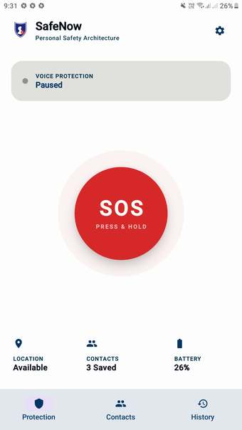
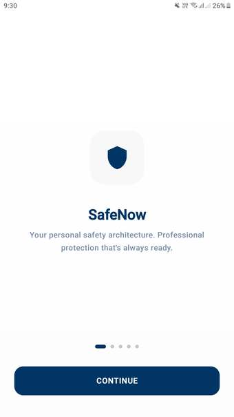
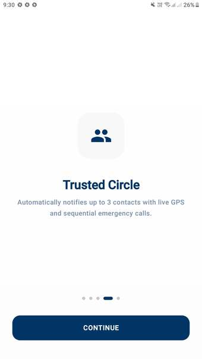
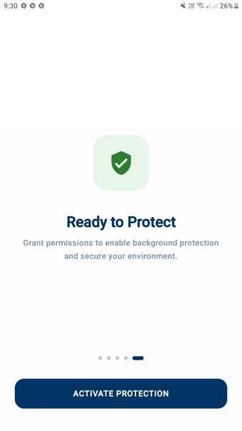
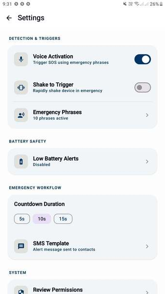
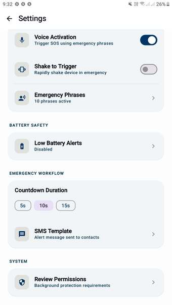
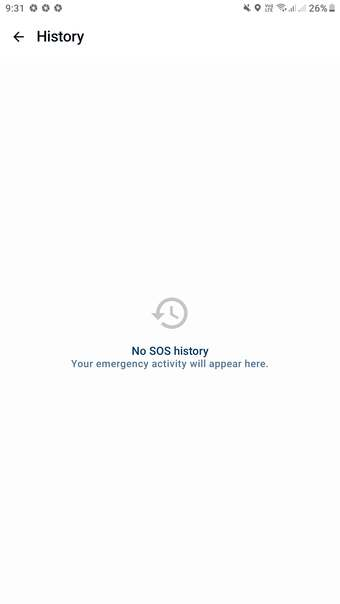
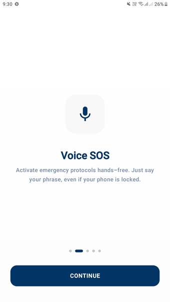
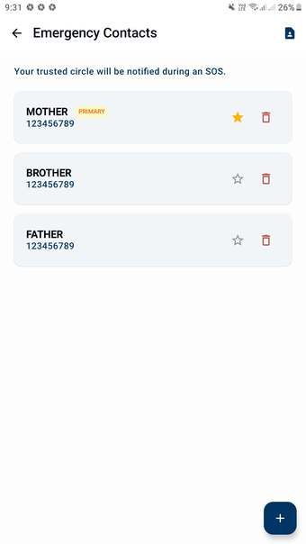
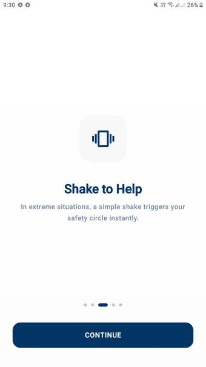

# SafeNow

**Voice-activated personal safety assistance for Android.**

> **Project links**
> - 🌐 **Official website:** https://uttaravallirohith.github.io/SafeNow/
> - 💻 **GitHub repository:** https://github.com/UTTARAVALLIROHITH/SafeNow
> - 📦 **Releases / APK downloads:** https://github.com/UTTARAVALLIROHITH/SafeNow/releases
> - 👤 **Developer:** [Uttaravalli Rohith](https://github.com/UTTARAVALLIROHITH)
> - ✉️ **Contact:** urohith033@gmail.com

SafeNow is presented as an Android safety app that helps a user alert a small trusted circle using an SOS button, emergency voice phrases, or a shake trigger.

> **Important:** SafeNow is a personal safety assistance tool, not a replacement for local emergency services. SOS delivery depends on device permissions, Android background-execution rules, network connectivity, GPS availability, battery level, and the recipient's phone/service.

## Website and download

- **Official website:** https://uttaravallirohith.github.io/SafeNow/
- **Source code:** https://github.com/UTTARAVALLIROHITH/SafeNow
- **Releases:** https://github.com/UTTARAVALLIROHITH/SafeNow/releases
- **Project contact:** urohith033@gmail.com
- **Android package:** `SafeNow.apk` (supplied package size: 19,055,488 bytes / about 18.2 MiB)
- **SHA-256:** `ef32d208d9a6be581f57e91f08c197fb5af3966227eb338ea2efe3247d1d2877`

The APK has **not yet been uploaded to a GitHub Release**. Do not treat the Releases link as proof that a downloadable APK is available until a release asset is published.

## Features described by the supplied SafeNow website

- SOS activation by pressing and holding the on-screen SOS control
- Optional voice activation using one of 10 built-in emergency phrases
- Optional shake-to-trigger activation
- Trusted circle of up to 3 contacts, with one primary contact
- Live GPS location sharing
- Sequential emergency calls to contacts
- Configurable SOS countdown: 5, 10, or 15 seconds
- Editable SMS message template

These are feature descriptions from the supplied project website. They have not been independently validated against Android source code in this repository.

## Setup overview

1. Obtain the APK from the official project distribution location once it is published.
2. Install it on a compatible Android device. Android may ask you to allow installation from the app used to open the APK.
3. Complete the in-app setup and review the permissions requested by the app.
4. Add and verify your trusted contacts.
5. Configure the SOS countdown and optional voice/shake triggers.
6. Test the setup safely with your trusted contacts before relying on it.

Only install APK files from a source you trust. Android may display a Play Protect warning for apps that are not distributed through Google Play.

## Permissions and data handling

The supplied website describes permissions for location, microphone, SMS, phone calls, contacts, notifications, display-over-other-apps, boot startup, and background operation.

The supplied website also explicitly says that some privacy details are **to be confirmed**, including whether voice audio is stored and where contacts/history are stored and how they can be deleted. A complete privacy policy and data-deletion instructions were not included in the supplied project archive. Do not assume that data is or is not collected until the app's implementation and policy are reviewed.

Before public release, document:
- What personal data is collected and why
- Whether voice audio is recorded, processed, or stored
- Where trusted contacts and SOS history are stored
- Whether location is shared continuously or only during an SOS event
- Retention and deletion procedures
- Any third-party services or analytics

## Reliability and emergency-use limitations

- SOS alerts and location sharing require a working network and available location services.
- Android battery optimization and background restrictions can affect background listening and location updates.
- Denied permissions can disable corresponding functionality.
- A switched-off phone, depleted battery, unavailable network, or unavailable GPS can prevent an alert from being delivered.
- Always contact your local emergency number directly when possible.

## App Screens

<table>
<tr><td align="center" valign="top" width="20%"><strong>Home Screen</strong> </td><td align="center" valign="top" width="20%"><strong>Welcome Screen</strong> </td></tr>
<tr><td align="center" valign="top" width="20%"><strong>Trusted Circle Intro</strong> </td><td align="center" valign="top" width="20%"><strong>Protection Setup</strong> </td></tr>
<tr><td align="center" valign="top" width="20%"><strong>Trigger Settings</strong> </td><td align="center" valign="top" width="20%"><strong>Emergency Workflow Settings</strong> </td></tr>
<tr><td align="center" valign="top" width="20%"><strong>SOS History</strong> </td><td align="center" valign="top" width="20%"><strong>Voice SOS Intro</strong> </td></tr>
<tr><td align="center" valign="top" width="20%"><strong>Emergency Contacts</strong> </td><td align="center" valign="top" width="20%"><strong>Shake-to-Help Intro</strong> </td></tr>
</table>

## Feedback and support

For project feedback and support, contact **urohith033@gmail.com**.

Do not use feedback forms or GitHub issues to request emergency help.

## Project contents

The supplied archive contains:
- `index.html` — the official single-page project website
- `SafeNow.apk` — Android installation package

The website and APK must be committed/published to this repository before this repository becomes the complete distribution source.

---

**Maintainer:** [UTTARAVALLIROHITH](https://github.com/UTTARAVALLIROHITH)
